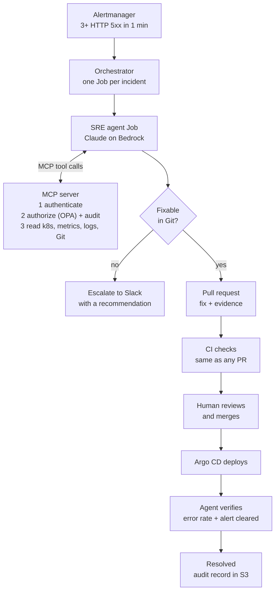
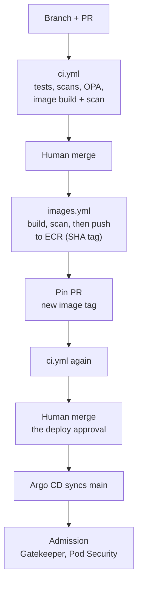

# Agentic SRE Platform

An AWS platform where an AI SRE agent (Claude on Amazon Bedrock) investigates production incidents and proposes fixes **as pull requests**, inside deterministic platform controls. A human approves every change.

The agent is treated as a workload, not a trusted administrator:
- it reads the platform only through a governed **MCP server** (authenticated, authorized by OPA, audited);
- it can only change production by opening a PR;
- it only calls an incident resolved when the error rate and the alert have actually cleared.

This is a proof of concept on a disposable environment: one command builds it, one tears it down.

**Stack:** Terraform · EKS · Argo CD (GitOps) · Envoy Gateway · kube-prometheus-stack · External Secrets · OPA (in-process, Gatekeeper, Conftest) · GitHub Actions with OIDC · Go · Claude Opus 4.6 on Bedrock.

## How an incident flows



1. **Detection.** Prometheus alerts when payment-api returns 3 or more 5xx responses in a minute. Alertmanager calls the orchestrator, which starts an isolated Kubernetes Job for that incident (de-duplicated, with a cooldown).
2. **Investigation.** The worker runs a Claude tool loop. Every tool call goes to the MCP server, which:
   - **authenticates** the agent's projected ServiceAccount token with a TokenReview;
   - lets an **OPA policy** decide the call;
   - then reads Kubernetes, Prometheus or GitHub on the agent's behalf.

   Logs are redacted, errors grouped into patterns, and metrics come from named queries only.
3. **Decision.** A fix that belongs in Git (for example a bad config commit) becomes a PR with the root cause and evidence. Anything else, such as a bad credential in Secrets Manager, escalates to Slack with the agent's recommended next steps.
4. **Approval and deploy.** CI validates the PR; a human merges; Argo CD deploys.
5. **Verification.** Deterministic code, not the model, waits until Argo CD has synced the merge and the rollout is complete. It then needs **both** the model's verdict and a code gate (error ratio under 1%, alert cleared) before the incident counts as resolved.
6. **Audit.** Every incident writes a JSON record to S3: every tool call and policy decision, the hypothesis, evidence, recommendation, PR, approval and verification. A read-only dashboard shows it.

## What keeps the agent safe

Safety doesn't depend on the model behaving. Even a fooled agent (say, by instructions planted in a log line) can't change production on its own:

| Layer | What it enforces | Where |
|---|---|---|
| **Identity** | No static credentials. AWS access through EKS Pod Identity: one Bedrock model through one inference profile, *write-only* audit records. MCP access through a projected ServiceAccount token (audience `mcp-server`). The agent holds no GitHub credential at all. | [`terraform/policies.tf`](terraform/policies.tf), [`apps/sre-agent/orchestrator.go`](apps/sre-agent/orchestrator.go) (`buildJob`) |
| **Network** | Incident workers: no ingress. Egress only to DNS, the MCP server, the Pod Identity agent and HTTPS out (Bedrock, S3). | [`network-policy.yaml`](gitops/workloads/dev/sre-agent/network-policy.yaml) |
| **Job admission** | A ValidatingAdmissionPolicy pins every incident Job: the agent's own image, its identity, the `investigate` command, one container, no host access, no Kubernetes API token. | [`admission-policy.yaml`](gitops/workloads/dev/sre-agent/admission-policy.yaml) |
| **MCP authorization** | One middleware authenticates, authorizes, audits and counts every MCP request. The OPA policy fails closed: read tools only for in-scope services; direct patches always denied (`required_path: create_pull_request`); the only write is a PR on an `agent/*` branch, under the service's GitOps path, never a Secret. | [`middleware.go`](apps/mcp-server/middleware.go), [`auth.go`](apps/mcp-server/auth.go), [`policy/mcp.rego`](apps/mcp-server/policy/mcp.rego) |
| **Pod security** | Gatekeeper and Pod Security `restricted`: no privilege, non-root, all capabilities dropped, pinned images, memory limits. | [`gitops/policies/dev/`](gitops/policies/dev/) |
| **Human approval** | The agent's PR goes through the same CI as anyone's, and a person merges it. Argo CD only deploys what's on `main`. | [`.github/workflows/ci.yml`](.github/workflows/ci.yml) |

`sre-agent whoami` and `mcp-server smoke` prove these from inside the cluster on every bring-up: allowed calls succeed, out-of-scope calls are denied.

## Policy: OPA at three levels

| Where | What it decides | Source |
|---|---|---|
| **MCP server**, on every agent request | What the agent may read and propose (fails closed) | [`apps/mcp-server/policy/mcp.rego`](apps/mcp-server/policy/mcp.rego) |
| **CI**, on every PR | Every manifest, using the same Gatekeeper policies (gator), plus no Secrets in Git (Conftest) | [`policy/gatekeeper/`](policy/gatekeeper/), [`policy/kubernetes/`](policy/kubernetes/) |
| **Cluster admission** (Gatekeeper) | Pod security, pinned images and memory limits: enforced in workload namespaces, audit-only elsewhere | [`gitops/policies/dev/`](gitops/policies/dev/) |

CI and the cluster run the **same** ConstraintTemplate files, so they can't drift apart. Gatekeeper fails *open* on purpose: a broken admission webhook mustn't take the cluster down, and CI is the layer that always enforces. The intentional-failure demo [`policy/examples/privileged-pod.yaml`](policy/examples/privileged-pod.yaml) is denied in both places.

## From a branch to production



- **AWS access from CI is OIDC only.** Each IAM role trusts exactly one workflow file on one ref ([`scripts/bootstrap-ci.sh`](scripts/bootstrap-ci.sh)).
- **Images are scanned before they're pushed** (tags are immutable), and every PR builds and scans the images too.
- **Actions are pinned to commit SHAs, and tools to image digests.** Every scanner exception is scoped and has a written reason ([`.trivyignore.yaml`](.trivyignore.yaml), [`.checkov.yaml`](.checkov.yaml)).
- **Jobs holding AWS credentials, or writing to the repo, only run for the repository owner** ([`scripts/ci/require-owner.sh`](scripts/ci/require-owner.sh)).

## Repository map

| Path | What's there |
|---|---|
| [`apps/mcp-server/`](apps/mcp-server/) | The governed gateway (Go): auth, OPA policy, tools, resources, prompts |
| [`apps/sre-agent/`](apps/sre-agent/) | The agent (Go): orchestrator, incident worker (Claude tool loop), `whoami`, audit dashboard |
| [`apps/payment-api/`](apps/payment-api/) | The demo workload (Go + Postgres) and its load generator |
| [`terraform/`](terraform/) | AWS substrate: VPC, EKS, IAM, Pod Identity, the Argo CD bootstrap. One root module plus modules, with per-environment `tfvars` |
| [`gitops/apps/dev/`](gitops/apps/dev/) | Argo CD app-of-apps: one Application per platform component, in sync waves |
| [`gitops/platform/dev/`](gitops/platform/dev/) | Cluster config: Gateway, certificate issuers, routing to humans (Slack) |
| [`gitops/policies/dev/`](gitops/policies/dev/) | Gatekeeper policies (also run in CI) |
| [`gitops/workloads/dev/`](gitops/workloads/dev/) | Manifests for payment-api, the MCP server and the agent, including network and admission policies |
| [`policy/`](policy/) | Policy tests (gator suite, Conftest) and the intentional-failure example |
| [`.github/workflows/`](.github/workflows/) | CI (`ci.yml`), image build and pin (`images.yml`), environment up/down (`environment.yml`) |
| [`scripts/`](scripts/) | Bootstrap scripts for long-lived pieces, `create-env.sh`, `destroy-env.sh`, image build and pin |
| [`docs/`](docs/) | [Architecture](docs/architecture.md), [production agent topology](docs/production-agent-topology.md), [runbooks](docs/runbooks/) (also read by the agent) |
| [`doc.md`](doc.md) | The original design brief and success criteria |

## Running it

**Prerequisites:** an AWS account and SSO profile, a Route53 hosted zone, Terraform ≥ 1.11, the AWS CLI, `kubectl`, `gh`, Docker, and two GitHub Apps (one read-only for Argo CD, one for the MCP server's PRs).

**Once per account.** These create the pieces that outlive environments:

```bash
scripts/bootstrap-state-bucket.sh
scripts/bootstrap-ci.sh
PROFILE=argocd APP_ID=<id> PEM_FILE=<app.pem> scripts/store-github-app.sh
PROFILE=mcp    APP_ID=<id> PEM_FILE=<app.pem> scripts/store-github-app.sh
```

A Slack incoming-webhook URL goes in Secrets Manager as `agentic-sre-dev/alertmanager/slack`. Account, region and domain are set in [`terraform/environments/dev.tfvars`](terraform/environments/dev.tfvars).

**Bring an environment up, or tear it down.** Locally, or from the `environment` workflow in GitHub Actions:

```bash
scripts/create-env.sh dev     # apply, wait for every Application, then prove the agent path (MCP smoke test, whoami)
scripts/destroy-env.sh dev    # ordered teardown; ECR images and audit records survive
```

**Trigger the demo incident.** Commit a wrong `DATABASE_HOST` in [`gitops/workloads/dev/payment-api/deployment.yaml`](gitops/workloads/dev/payment-api/deployment.yaml). Within about a minute of the first 500s the agent starts. Watch it on the dashboard:

```bash
kubectl -n sre-agent port-forward svc/sre-dashboard 8088:80    # http://localhost:8088
```

## Trade-offs and known gaps

- **The agent proposes; it never merges.** Autonomy would be earned per change type, using the audit trail as evidence.
- **No branch protection.** The repo is private on GitHub Free, so "CI must pass before merge" is enforced by convention and the owner check, not by GitHub. Production would use branch protection, required checks and Environment reviewers.
- **A PoC-sized environment:** single-AZ nodes, one NAT gateway, ephemeral Prometheus, and the agent in the same cluster it watches. [`docs/production-agent-topology.md`](docs/production-agent-topology.md) describes running the agent from a separate operations account.
- **A demo-tuned alert.** Three errors in a minute is deliberately sensitive. Production would alert on an SLO burn rate, since each firing starts a billed investigation.
