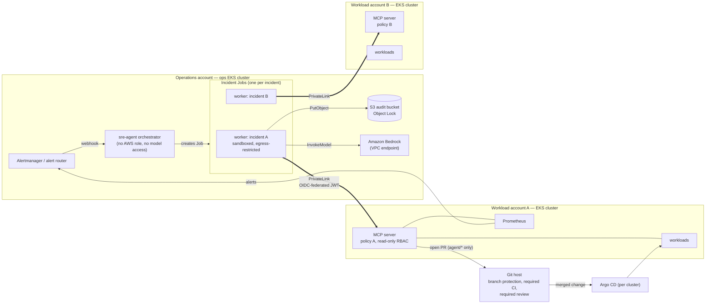
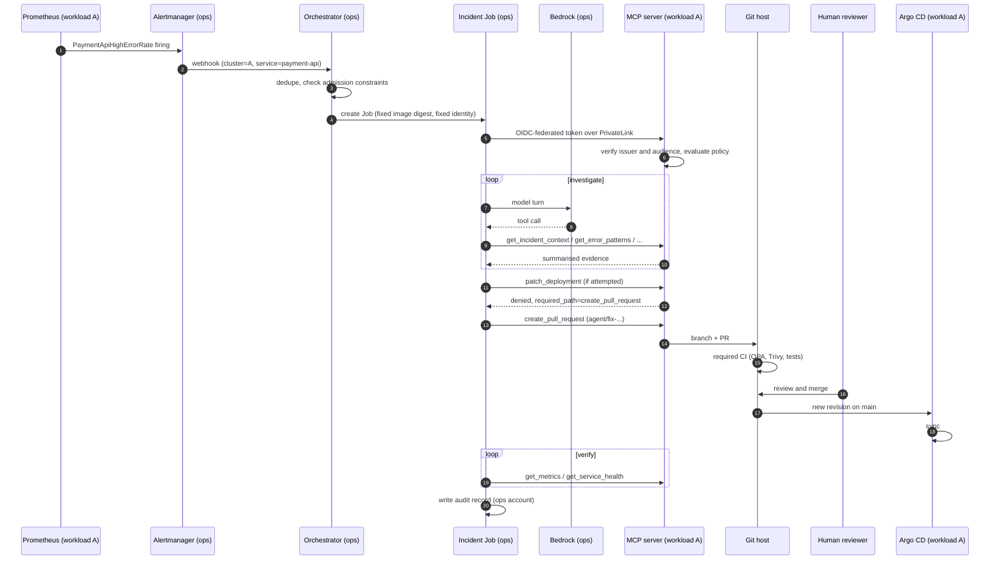

# Production topology for the SRE agent

The PoC runs the SRE agent in the same EKS cluster as the workloads it
investigates (see [architecture.md](architecture.md)). That's fine for a
demo, and wrong for production. This document describes the design we'd use
instead, why, and what it costs.

## Summary

- Run the agent in a **dedicated operations cluster in a separate AWS
  account**, not alongside the workloads.
- Keep an **MCP server in every workload cluster**, so each cluster enforces
  its own policy with its own namespaced, read-only access.
- Connect them **privately** (PrivateLink), and authenticate the agent to each
  MCP server with **federated workload identity** (its cluster's OIDC
  issuer), not with tokens that only one cluster can verify.
- Run **one Kubernetes Job per incident**, launched by an orchestrator that
  has no model access and no AWS role. Isolate the Jobs further with
  egress restrictions and, if the agent ever executes code, a VM-backed
  sandbox.
- Gate every change on **branch protection** in the Git host, not only on
  the MCP server.

## Why not in the same cluster

| Concern | Same cluster (PoC) | Separate operations cluster |
|---|---|---|
| **Availability when it matters** | If the incident takes down nodes, DNS, the CNI or the API server, the agent fails with the cluster it's meant to fix. | The agent keeps running and can still investigate through whatever MCP and telemetry paths remain. |
| **Blast radius: workload compromised** | An attacker in the cluster is next to the agent and its identity (Bedrock access, audit bucket). | Nothing in the workload cluster can reach the agent, its credentials or its audit trail. |
| **Blast radius: agent compromised** | A hijacked agent pod sits inside the network it's investigating. | It reaches a workload cluster only through that cluster's MCP endpoint, under that cluster's policy. |
| **Audit integrity** | The audit bucket's writer lives in the cluster being audited. | Audit records live in the operations account, out of reach of workload admins. |
| **Fleet scale** | One agent per cluster. | One agent serves many clusters and accounts. |
| **Model and data governance** | Bedrock access is granted in every workload account. | One account holds model access, quotas, invocation logging and budgets. |

## Target architecture

### Request path for one incident

## Design details

### Identity across clusters

TokenReview only verifies tokens issued by the *same* cluster, so the PoC's
MCP authentication doesn't carry over. Options, best first:

1. **OIDC federation (recommended).** The ops cluster's ServiceAccount
   issuer is public (EKS publishes its OIDC discovery document). Each MCP
   server verifies the worker's projected token as a JWT: signature against
   the ops cluster's JWKS, `iss` equal to the ops cluster's issuer, `aud`
   equal to that MCP server's audience (for example
   `mcp.workload-a.internal`), and `sub` equal to
   `system:serviceaccount:sre-agent:sre-agent`. No shared secret, and tokens
   still expire in minutes.
2. **AWS IAM (SigV4).** The worker signs requests with its Pod Identity role;
   the MCP server validates them through an API Gateway or Lambda
   authoriser. Strong, but adds AWS-specific plumbing to every MCP call.
3. **Mutual TLS.** Through a service mesh with a shared trust domain, or
   certificates from a private CA. Works, but needs certificate lifecycle and
   mesh federation across clusters.

The policy keeps one caller per cluster, so the same principle holds:
unknown caller, denied.

### Network

- Each workload cluster exposes its MCP server through an **internal NLB**
  published as a **PrivateLink endpoint service**. The ops VPC consumes it
  with an interface endpoint. No public exposure, no VPC peering, no
  overlapping-CIDR problems.
- In the workload cluster, a NetworkPolicy admits the NLB's traffic to the
  MCP port only, as the PoC does for the `sre-agent` namespace.
- In the ops cluster, incident Jobs have **default-deny egress** with
  explicit allows: DNS, the PrivateLink endpoints, the Bedrock and S3 VPC
  endpoints, and the Pod Identity agent. With VPC endpoints for everything
  the worker calls, it needs no internet egress at all, which removes the
  exfiltration channel a prompt injection would use.
- Kubernetes NetworkPolicy can't filter by hostname. If any internet egress
  remains, put it behind an egress proxy or AWS Network Firewall with a
  domain allow-list.

### Execution model: one Job per incident

The orchestrator is deliberately weak: it receives webhooks, de-duplicates,
and creates Jobs. It holds no model access and no AWS role.

Each incident runs in its own Job, which gives:

- **Isolation between incidents.** Prompt injection from one incident's logs
  can't reach another's context or memory.
- **Short-lived credentials.** The worker's token and model session exist
  only for that incident.
- **Natural limits.** `activeDeadlineSeconds`, resource limits, and
  `backoffLimit: 0` (an incident is never silently retried).
- **A physical audit boundary.** One pod, one log stream, one record.

The new risk is the orchestrator's permission to create Jobs: creating a pod
that runs as the worker's ServiceAccount means obtaining the worker's AWS
role through Pod Identity. Constrain it at admission time:

- RBAC: the orchestrator may create Jobs in its own namespace only.
- A `ValidatingAdmissionPolicy` on that namespace requires the worker's
  ServiceAccount, an image from the agent's repository **by digest**, a
  single container, no host namespaces or host paths, the restricted
  security context, and the `investigate` entrypoint.

### Sandboxing

A Job is isolated from other Jobs but shares the node's kernel.

- **The agent only calls APIs** (Bedrock, MCP, S3): the realistic threat is
  prompt injection steering its decisions, not code escaping a container.
  The controls that matter are policy-gated tools, no credentials in the
  agent, human approval of every change, and no egress to anywhere else. A
  distroless image with no shell removes the obvious tools.
- **If the agent ever executes code** (running tests, `kubectl`, scripts it
  wrote), give it a real sandbox:
  - **EKS on Fargate**: each pod runs in its own microVM; simplest on AWS.
  - **gVisor or Kata Containers** through a `RuntimeClass`.
  - A dedicated, disposable microVM per task.
- Run worker Jobs on a **separate node group** (taints and tolerations)
  either way, so agent pods never share nodes with the orchestrator or other
  operations tooling.

### Change control

- **Branch protection on `main`**: pull request required, one approving
  review, required status checks (unit tests, Conftest/OPA, Trivy,
  `promtool`), no bypass for apps. This is the gate the PoC can't enforce on
  a private GitHub Free repository.
- The MCP server's Git credential stays scoped to one repository, and its
  policy still restricts paths and branch names.
- Separate the Git credential per workload cluster, so a compromised MCP
  server in one cluster can't propose changes for another.

### Audit

- Audit records go to a bucket in the **operations account** with **Object
  Lock** (compliance mode), so neither the agent nor a workload admin can
  alter history.
- Bedrock **model invocation logging** to the same account captures every
  prompt and completion.
- The MCP servers' audit logs ship to central logging, so tool decisions can
  be correlated with the agent's own record.

## Trade-offs

| | Gain | Cost |
|---|---|---|
| Separate ops cluster and account | Survives the incident; blast-radius separation; central audit and model governance | A second cluster to run; cross-account networking and identity |
| PrivateLink per workload cluster | Private, no peering, CIDR-independent | An endpoint service, an internal NLB, and an interface endpoint per cluster; hourly charges |
| OIDC-federated tokens | No shared secrets; short-lived; standard | MCP servers must verify JWTs themselves and track the issuer's keys |
| Job per incident | Isolation, short-lived credentials, natural limits | Admission policy to write and maintain; a few seconds of start-up per incident |
| VPC endpoints instead of internet egress | Removes the exfiltration path | Endpoint charges per AZ; every new dependency needs an endpoint |
| Fargate or gVisor | Kernel-level isolation | Slower start; fewer features (DaemonSets, some volumes); cost |

## Best practices

1. **The agent is a workload, not an administrator.** It gets no
   credentials beyond its own narrow identity; every capability comes from a
   governed tool.
2. **Enforce outside the model.** Policy in the MCP server, branch
   protection in Git, IAM in AWS, RBAC in Kubernetes. Prompts guide; they
   don't enforce.
3. **Read through summaries, write through review.** Reads are rich but
   redacted and size-capped; the only write is a pull request.
4. **One incident, one sandbox.** Fresh process, short-lived credentials,
   hard limits, nothing carried over.
5. **Fail closed.** Unknown caller, unknown tool, or policy error means deny.
6. **Verify, don't assume.** A merged fix isn't resolution; metrics are.
7. **Make it auditable by someone who doesn't trust the agent.** Records the
   agent can't modify, and independent tool logs to check them against.

## Migrating from the PoC

1. Create the ops account and cluster. Move the orchestrator and incident
   Jobs there, with Bedrock and S3 VPC endpoints.
2. Add OIDC JWT verification to the MCP server alongside TokenReview, keyed
   by issuer, then switch callers over.
3. Expose each workload MCP server through an internal NLB and PrivateLink;
   restrict its NetworkPolicy to the NLB.
4. Move the audit bucket to the ops account with Object Lock.
5. Turn on branch protection with required checks.
6. If the agent gains code execution, move worker Jobs to Fargate or a
   gVisor RuntimeClass.
